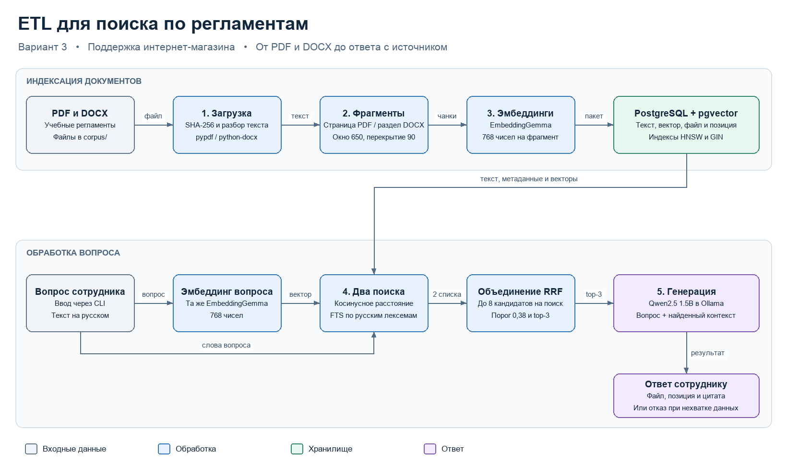

# Отчёт по практической № 2

## 1. Вариант и задача

| Поле | Значение |
|---|---|
| ФИО (для VK Education) | Воднев Даниил Евгеньевич |
| Группа | БИВТ-24-АЭ-3 |
| Тема | Вариант 3. Поиск по документам (RAG + векторная БД) |
| Состав решения | Python для подготовки данных, PostgreSQL с pgvector для индекса, Ollama для эмбеддингов и ответа |
| Данные, объём | 4 PDF и 4 DOCX, 323 281 байт. В отчёте используются вымышленные регламенты интернет-магазина |

Сотрудник поддержки задаёт вопрос обычным языком и получает ответ с цитатой и указанием, где её проверить. Например, по вопросу о сроке хранения посылки указываются файл и страница регламента доставки.

## 2. Источники и способы сбора

| Источник | Тип | Способ сбора |
|---|---|---|
| Возвраты, доставка, платежи, контроль качества | PDF с текстовым слоем | Чтение из `corpus/` через pypdf. Для каждого фрагмента сохраняется номер страницы |
| Учётные записи, инциденты, промокоды, склад | DOCX | Чтение абзацев через python-docx. Границы разделов берутся из стилей заголовков |
| Вопросы сотрудника | Текст из CLI | По запросу формируются поисковые слова и эмбеддинг. Вопросы не записываются в индекс |

Для регламентов подходит пакетное обновление. У источника редко меняются все документы сразу, поэтому повторно обрабатываются только изменённые файлы. В рабочей системе тот же каталог можно собирать по расписанию из утверждённой базы документов, сверяя версии и права доступа.

## 3. Архитектура



[Редактируемая схема Draw.io](architecture.drawio)

**Индексы.** В PostgreSQL лежат текст, источник и вектор. HNSW с косинусным расстоянием нужен для приближённого поиска соседей на большом корпусе. Он требует памяти и времени на построение. Для небольшого корпуса планировщик может выбрать точный просмотр таблицы. Индекс GIN ускоряет поиск по лексемам русского текста. В учебной базе индексы созданы. Время и полноту HNSW на рабочем объёме нужно сверять с точным поиском. Если 5 000 документов дают по 10 фрагментов, 50 000 векторов по 768 float32 займут около 146 МиБ без учёта текста, метаданных и индексов.

**Гибридный поиск.** Векторная ветка сравнивает смысл. Лексическая ветка ищет совпадения по словам и кодам, например `PAY-502`. Из каждой ветки берётся до восьми результатов. RRF складывает вклад `1 / (60 + место)` от каждой ветки. Так не приходится сравнивать напрямую косинусное расстояние и баллы полнотекстового поиска. Если максимальное косинусное сходство ниже 0,38, система возвращает отказ до генерации. Иначе три фрагмента с наибольшим итогом RRF поступают в LLM. Порог выбран на учебном наборе. У 12 вопросов с эталоном ближайший фрагмент имел сходство от 0,415, а у трёх вопросов вне темы максимум был 0,319. При смене модели или корпуса порог потребуется проверить заново. [Результаты подбора](evidence/relevance-calibration.json)

## 4. Docker — что поднялось

| Блок | Статус |
|---|---|
| PostgreSQL 17 + pgvector | Запущен. Сохранил 8 документов и 32 фрагмента. Созданы HNSW и GIN |
| Ollama | Запущен. Выполнены запросы к EmbeddingGemma и Qwen2.5 |
| Python ETL и CLI | Запущен. Выполнены индексация, три режима поиска и проверка генерации |

Запуск выполнен на Mac с Apple Silicon через Colima. На Mac под Colima выделено 4 ГБ памяти и 3 CPU. Все три сервиса описаны в [Compose](docker-compose.yml). На Mac использован установленный `docker-compose`. В среде с Compose plugin те же команды выполняются как `docker compose`.

```bash
docker compose up -d --build --wait
docker compose exec -T ollama ollama pull embeddinggemma:300m
docker compose exec -T ollama ollama pull qwen2.5:1.5b
docker compose exec -T rag python pipeline.py index
docker compose exec -T rag python pipeline.py eval
docker ps
```

Вывод `docker ps` по контейнерам работы.

```text
NAMES                     STATUS
rag-practice-2-rag-1      Up 3 minutes
rag-practice-2-ollama-1   Up 10 minutes (healthy)
rag-practice-2-db-1       Up 13 minutes (healthy)
```

Модели были предварительно загружены в локальный кэш и подключены к контейнеру Ollama через `OLLAMA_STORAGE`. При обычном запуске Compose создаёт именованный том.

| Проверка индекса | Результат |
|---|---|
| Первый запуск | 8 новых файлов, 32 фрагмента |
| Повторный запуск | 8 файлов пропущены, 32 фрагмента |
| Изменение одного DOCX | Обновлён 1 файл, 7 пропущены. Новый срок заменил старый в индексе |
| Повреждённый PDF | Ошибка разбора, индекс остался в предыдущем состоянии |
| Удаление файла с `--prune` | 7 файлов и 28 фрагментов. После возврата корпуса восстановились 8 и 32 |

Проверки сохранены в [evidence/](evidence/). Совместимость запроса с HNSW подтверждена отдельно через `EXPLAIN` с отключённым последовательным просмотром. Ускорение на большом наборе отдельно не измерялось.

## 5. Путь данных

| Шаг | Что происходит | Результат |
|---|---|---|
| 1. Загрузка | Считается SHA-256 файла. Из новых или изменённых документов извлекается текст | Текст с именем файла и страницей PDF или заголовком DOCX |
| 2. Фрагменты | Текст нормализуется по пробелам и режется внутри страницы или раздела. Окно до 650 символов, перекрытие около 90, по границе слов | Фрагменты до 650 символов с идентификатором вида `returns.pdf#01` |
| 3. Эмбеддинги | EmbeddingGemma готовит 768 чисел для каждого фрагмента. Текст, вектор и источник записываются одной транзакцией | Индекс для поиска. При смене содержимого или версии модели фрагменты строятся заново |
| 4. Поиск | Вопрос кодируется той же моделью. PostgreSQL возвращает векторную и полнотекстовую выдачи, затем применяется RRF и порог сходства | Три фрагмента для ответа или отказ до LLM |
| 5. Генерация | Qwen2.5 получает вопрос и найденный контекст. Код проверяет ссылку на фрагмент, дословную цитату и вхождение короткого ответа в цитату | Короткий ответ, источник и цитата. При отсутствии подтверждающей цитаты возвращается отказ |

При ошибке разбора документа транзакция откатывается. PDF без текстового слоя потребует отдельного OCR, а сложные таблицы и рисунки требуют своего способа извлечения.

### Проверка качества поиска

До прогона для 12 вопросов задан один эталонный фрагмент. Есть прямые вопросы, коды и перефразировки. Все три режима оценены на одной разметке и по трём первым результатам. Recall@3 — доля вопросов, для которых найден эталон в первых трёх. MRR@3 — среднее обратное место эталона, с нулём за пропуск. Метрики оценивают поиск до вызова LLM.

| Поиск | Эталон в первых трёх | Recall@3 | MRR@3 |
|---|---:|---:|---:|
| Векторный | 12 / 12 | 1,000 | 1,000 |
| Полнотекстовый | 9 / 12 | 0,750 | 0,694 |
| Гибридный, RRF | 12 / 12 | 1,000 | 0,917 |

Все четыре коротких кода нашлись на первом месте и в векторном, и в полнотекстовом поиске. FTS пропустил три перефразировки, в том числе вопрос про «свёрток в ПВЗ». Гибрид нашёл все эталоны, но по двум перефразировкам поставил нужный фрагмент вторым. На этом корпусе векторный режим дал лучший порядок. Результаты всех 12 вопросов сохранены в [retrieval.json](evidence/retrieval.json).

### Проверка ответов с цитатой

| Вопрос | Результат | Оценка |
|---|---|---|
| Срок хранения посылки | [5 календарных дней со дня поступления · `delivery.pdf#02`, с. 2](evidence/answer-delivery.json) | Верный ответ с источником |
| Уведомление при массовом сбое | [Отказ: В загруженных регламентах не найдено подтверждение.](evidence/answer-incident.json) | Ложный отказ: нужный фрагмент найден, ответ не прошёл проверку |
| Пароль гостевого Wi-Fi | [Отказ: В загруженных регламентах не найдено подтверждение.](evidence/answer-missing.json) | Верный отказ: такой информации в корпусе нет |

Проверка вхождения делает цитаты проверяемыми и может отклонить правильный пересказ. Смысловую релевантность цитаты дополнительно оценивают на контрольных вопросах.

**Роль data engineer.** От него зависят загрузка, разбиение, воспроизводимость индекса, обновление и метрики поиска. Качество поиска и качество ответа модели проверяются отдельно. Цитату можно проверить программно, а соответствие смысла ответа цитате нужно оценивать на контрольных вопросах. Для внутренних документов с разными правами доступа следует фильтровать источники по правам пользователя до передачи контекста в LLM.

## 6. Выводы

Прототип индексирует PDF и DOCX. Порог сходства отсёк запрос про гостевой Wi-Fi, для которого до порога модель ошибочно выбрала раздел о восстановлении доступа. Дополнительный вопрос о цене билета в планетарий тоже получил отказ. [Проверки порога](evidence/relevance-checks.json) Для вопроса о посылке получен ответ со ссылкой на страницу PDF. Повторная загрузка сохранила 32 фрагмента. На небольшом наборе смысловой поиск справился лучше поиска по словам. Гибрид сохранил полноту, но не улучшил первые позиции. Для рабочего корпуса я бы собрал реальные вопросы сотрудников и проверил отдельно точность ссылок, долю обоснованных отказов и время поиска. Это покажет, оправдана ли дополнительная ветка FTS и какой баланс между точным поиском и HNSW подходит по скорости.

### Мой любимый десерт

Тирамису.

### Материалы

- [Условие и форма практической работы](https://github.com/m1705161/p2/tree/80f1f8d3b11473331bfe31aa867715ba1ac50a47)
- [pgvector — точный и приближённый поиск, HNSW](https://github.com/pgvector/pgvector)
- [PostgreSQL — полнотекстовый поиск](https://www.postgresql.org/docs/17/textsearch-controls.html)
- [Ollama — получение эмбеддингов](https://docs.ollama.com/api/embed)
